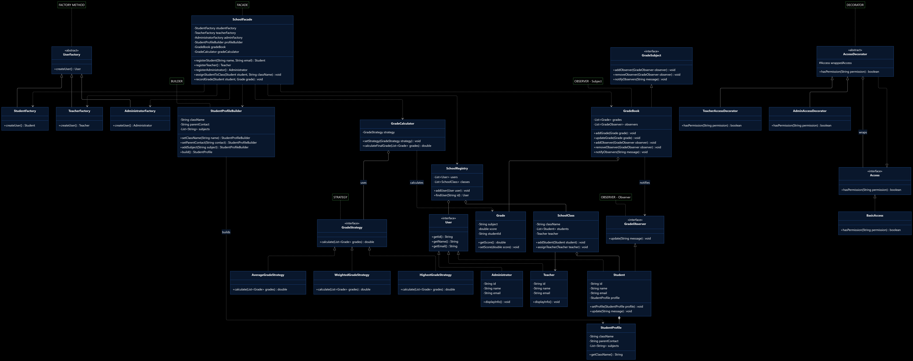

# Software Design Patterns in Java

A consolidated collection of Gang of Four (GoF) object-oriented design patterns implemented in Java, covering creational, structural, and behavioral patterns with practical domain models and UML diagrams.

---

## Repository Structure

| Module | Category | Description & Key Implementations |
| :--- | :--- | :--- |
| **[`builder-pattern`](https://github.com/93rdmogila/software-design-patterns/tree/main/builder-pattern)** | Creational | Step-by-step construction of complex objects (`Character`, `CharacterBuilder`, `WarriorBuilder`, `MagicianBuilder`, `Role`). |
| **[`factory-pattern`](https://github.com/93rdmogila/software-design-patterns/blob/main/factory-pattern)** | Creational | Factory Method & Abstract Factory implementations for extensible object instantiation (`Logistics`, `RoadLogistics`, `SeaLogistics`, `Transport`, `Truck`, `Ship`). |
| **[`bridge-pattern`](https://github.com/93rdmogila/software-design-patterns/blob/main/bridge-pattern)** | Structural | Decoupling report abstractions from output formatters (`AttendanceReport`, `GradeReport`, `HtmlFormatter`, `TextFormatter`, `MarkDownFormatter`). |
| **[`facade-pattern`](https://github.com/93rdmogila/software-design-patterns/blob/main/facade-pattern)** | Structural | Simplified unified interface over an e-commerce checkout subsystem (`Cart`, `InventoryService`, `Product`, `CreditCard`). |
| **[`strategy-pattern`](https://github.com/93rdmogila/software-design-patterns/blob/main/strategy-pattern)** | Behavioral | Encapsulating interchangeable runtime algorithms behind a unified strategy interface. |
| **[`visitor-pattern`](https://github.com/93rdmogila/software-design-patterns/blob/main/visitor-pattern)** | Behavioral | Double-dispatch file system traversal with cycle detection and duplicate validation (`DirectoryNode`, `FileNode`, `TotalSizeVisitor`, `SearchVisitor`, `StatisticsVisitor`). |
| **[`Lectures.zip`](https://github.com/93rdmogila/software-design-patterns/blob/main/Lectures.zip)** | Reference | Archived lecture slides, theoretical notes, and pattern specifications. |
| **[`mermaid-diagram.png`](https://github.com/93rdmogila/software-design-patterns/blob/main/mermaid-diagram.png)** | Architecture | Visual UML / Mermaid class diagram illustrating structural relationships across the repository. |

---

## Architecture Overview



---

## Tech Stack & Environment

* **Language:** Java (JDK 25 LTS)
* **Build & Testing:** Apache Maven, JUnit 5
* **Documentation & Modeling:** Mermaid.js, UML Class Diagrams

---

## Getting Started

### Prerequisites
* **JDK 25** or higher installed and configured in `PATH`
* **Apache Maven** (for Maven-structured pattern modules)

### Running Locally
1. **Clone the repository (including submodules):**
   ```bash
   git clone --recurse-submodules [https://github.com/93rdmogila/software-design-patterns.git](https://github.com/93rdmogila/software-design-patterns.git)
   cd software-design-patterns
